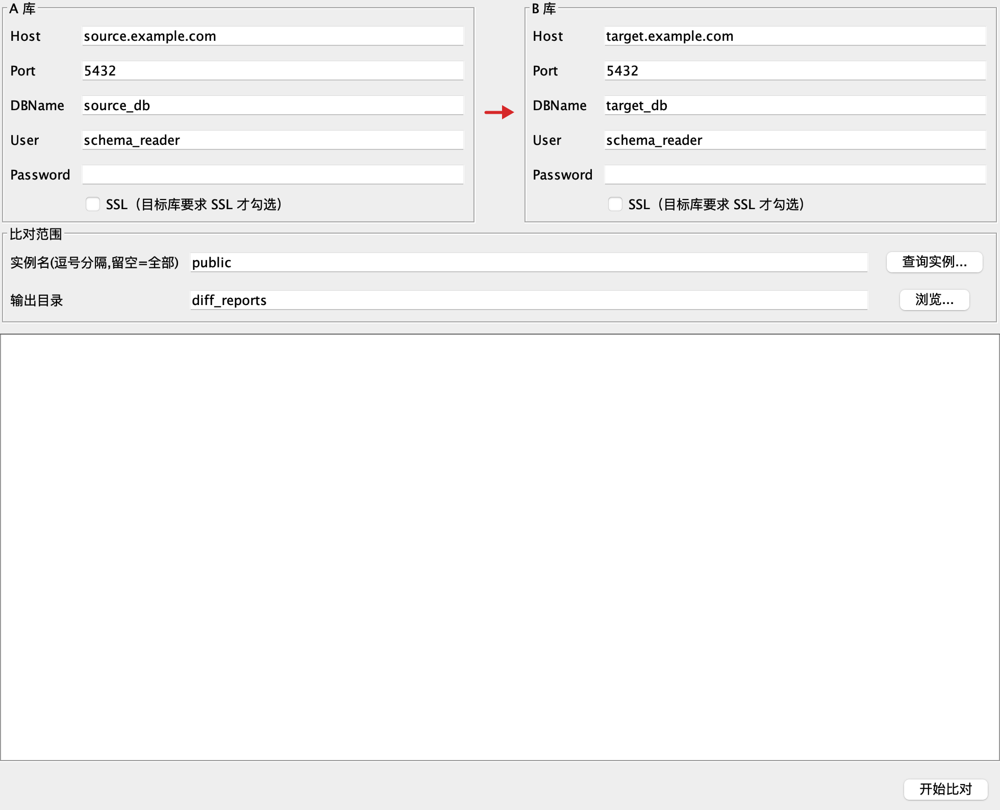

# pg-schema-diff

pg-schema-diff 是一个 PostgreSQL 表结构对比工具，使用 Java Swing 提供桌面界面。它以 **A 库为基准、B 库为目标**，找出 B 库缺失的表和列，并按 schema 导出用于补齐结构的 SQL。适合检查开发、测试等环境之间的结构差异。比对过程读取数据库元数据，导出的 SQL 由使用者审核后在 B 库执行。

## 界面预览



## 支持范围

- **B 库缺表**时生成 `CREATE TABLE`，并尽量还原主键、唯一约束、独立索引、序列以及表和列的注释。
- **B 库缺列**时生成 `ALTER TABLE … ADD COLUMN`，保留列类型、默认表达式、identity 定义和列注释。默认表达式引用的函数、序列或类型需要在 B 库可用。
- 支持 PostgreSQL 的 `GENERATED ALWAYS AS IDENTITY` 和 `GENERATED BY DEFAULT AS IDENTITY`。底层序列可读时保留递增步长、上下界、起始值、缓存和循环参数。读取不全时会记录警告，未输出的参数由目标库采用默认值。
- **B 库缺整个 schema** 时在报告中提示手工创建。

默认按对象名称检查是否缺表或缺列。勾选「比对字段类型和长度」后，日志和 SQL 报告会列出同名列的 A、B 类型定义，包括字符长度和数值精度等差异，供手工审核。类型差异以 SQL 注释输出。同名列的默认值、可空性和 identity 差异暂未纳入比对。工具不迁移行数据，也不生成删除语句。外键和 `CHECK` 约束需单独处理。连接账号应能看到需要比对的对象，否则结果可能不完整。

## 构建和运行

需要 JDK 11 或更高版本、Maven，以及能连接两个 PostgreSQL 数据库的桌面环境。

```bash
git clone https://github.com/javafast/pg-schema-diff.git
cd pg-schema-diff
mvn package
java -jar target/pg-schema-diff-gui.jar
```

## 使用步骤

1. 填写 A、B 两个 PostgreSQL 库的地址、端口、数据库名、用户名和密码。
2. 输入要比对的 schema，多个名称用逗号分隔，也可以点「查询实例…」从 A 库选择。留空时比对账号可见的非系统 schema。
3. 选择输出目录，默认是 `diff_reports`。点击「开始比对」，查看窗口日志和本轮生成的 `<schema>.sql`。
4. 审核生成的 SQL，再用数据库客户端在 B 库执行。

程序通过 Java Preferences 在当前系统用户配置中保存上次填写的连接参数，包括密码。
